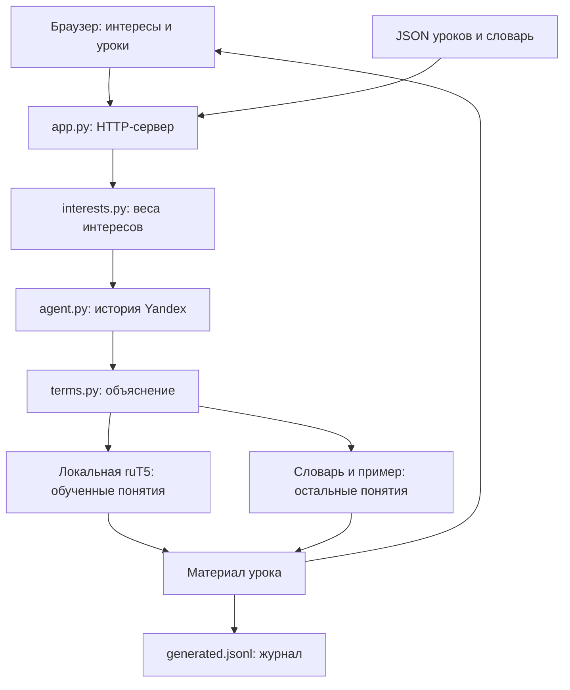
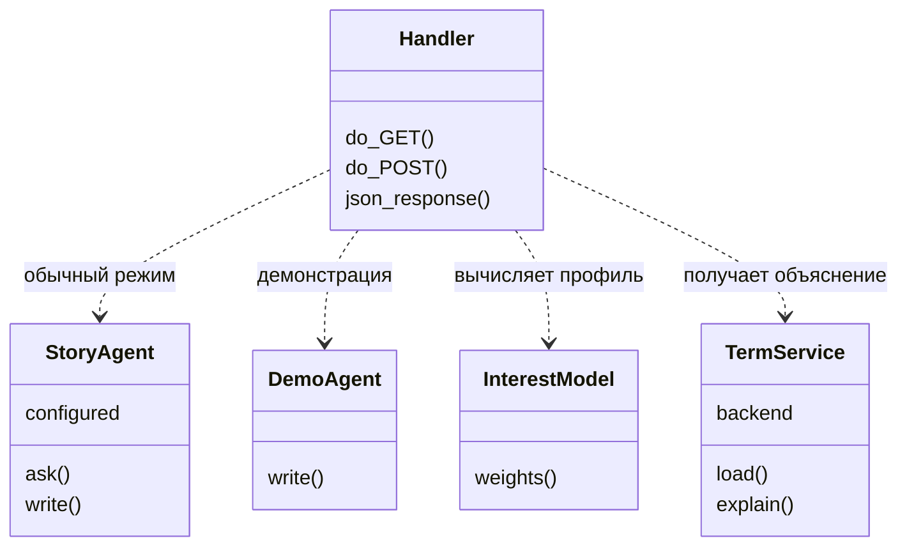

# FinStory. Диаграммы

Диаграммы описывают структуру подготовленной веб-версии. При изменении имён компонентов в сдаваемом коде диаграмму классов следует сверить с ним. Неподтверждённые банковские интеграции не включены.

## Компоненты и данные

## Подготовка нового урока

```mermaid
sequenceDiagram
    participant U as Браузер
    participant S as Сервер
    participant A as Yandex API
    participant T as Модель терминов
    U->>S: Номер урока, интересы, предыдущая глава
    S->>S: Тема, определения, веса
    S->>A: Запрос истории
    A-->>S: История и факты
    opt Нарушена длина
        S->>A: Исправить длину и обновить факты
        A-->>S: Исправленный ответ
    end
    Note over S,A: Не более двух запросов на исправление
    S->>T: Обученный термин, значение, история, веса
    T-->>S: Контекстное объяснение
    S->>S: Запись источника и результата в журнал
    S-->>U: Готовый урок
    U->>U: Сохранение материала в браузере
```

Диаграмма последовательности показывает успешный путь для обученного понятия. Для необученного понятия сервер использует словарный вариант. Если ответ не проходит проверки после повторных попыток, сервер возвращает ошибку, а не готовый урок.

## Основные классы

Handler принимает запросы; сборку урока выполняют функции app.py. Связи обозначают использование компонентов через эту связку, а не наследование.

## Пример объектов во время запроса

- `handler: Handler` обрабатывает запрос браузера.
- `agent: StoryAgent` отправляет запрос истории.
- `TERMS_MODEL: TermService` хранит загруженную модель между запросами.
- `lesson: dict` содержит тему, понятие и вопросы.
- `weights: dict` содержит относительные веса интересов.
- `result: dict` содержит главу, героя, факты и источник истории.

Это описание структуры объектов, без персональных ответов и ключей.
